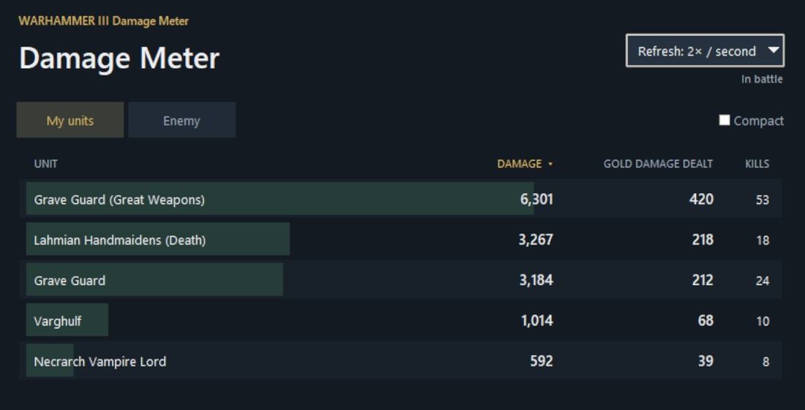
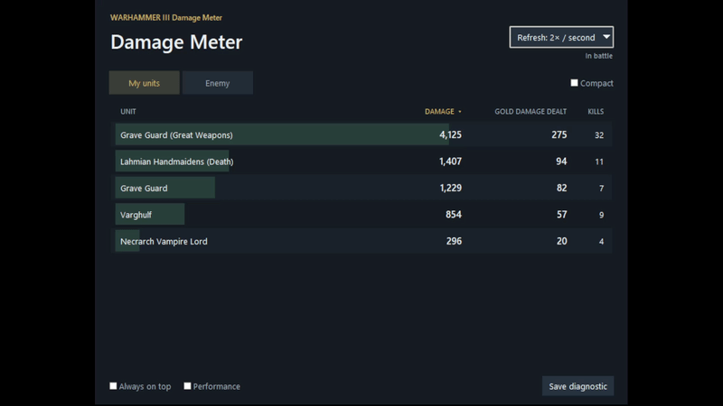
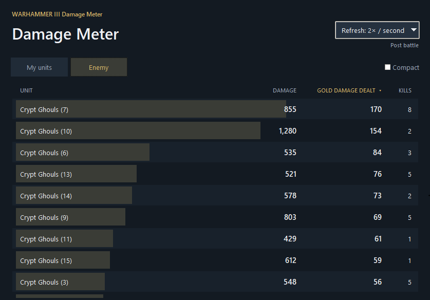
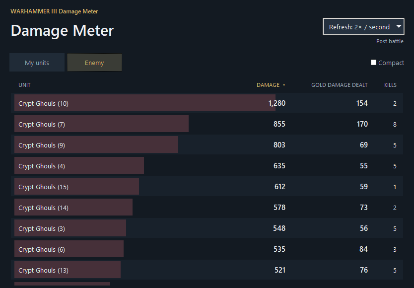
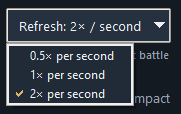

  

# WARHAMMER III Damage Meter

A separate Windows companion window for **Total War: WARHAMMER III**. Follow each unit's damage, gold damage dealt, and kills while a battle plays out.

## Download and install

1. Download [**DamageMeter.exe**](https://github.com/Americanyutao/Warhammer3-Damage-Meter/raw/refs/heads/main/DamageMeter.exe).
2. Save it anywhere convenient and double-click **DamageMeter.exe**. There is no installer and no separate Python setup.
3. Start WARHAMMER III and enter a battle. The meter connects automatically.

Requires **64-bit Windows 10 or Windows 11** and a supported Windows game build. Game updates may require a new Damage Meter release. The first launch prepares the bundled runtime and may take a few seconds.

## Features

- **Damage, gold damage dealt, and kills** for individual units.
- **My units** includes allied units; switch to **Enemy** for the opposing side.
- **Click Damage or Gold Damage Dealt** to sort. Damage is the default; tied values sort by unit name.
- **Smooth counters and bars**, with half-second transitions between updates.
- **Camera-independent tracking** in a separate, resizable window.
- **Post-battle results** remain available until the next battle.
- **Compact view**, mouse-wheel scrolling, and **Always on top**.
- **System tray controls** to show, hide, or exit the app.
- **Adjustable refresh rate**: 0.5, 1, or 2 updates per second.

## Gold damage sorting

Click **Gold Damage Dealt** to rank units by the gold value of their damage. The bars turn gold. Click **Damage** to return to damage sorting.

## Army views and refresh rate

Use **My units** and **Enemy** to switch views. Repeated unit names receive numbered suffixes so they remain distinguishable.

The refresh selector is at the top right. Lower refresh rates reduce the app's workload; number and bar animations remain smooth.

## Closing the app

When the tray icon is available, closing or minimizing the window sends it to the tray. Click the tray icon to show or hide the window, or right-click it and choose **Exit**. If the tray is unavailable, closing the window exits normally.

To remove the app, exit it and delete **DamageMeter.exe**. You can also delete `%LOCALAPPDATA%\WH3DamageMeter` to remove its local runtime files.

## FAQ

### Do I need the GitHub files, Python, or anything besides the EXE?

No. Download **DamageMeter.exe**, run it, and start a supported version of WARHAMMER III. You do not need the repository's source files, pictures, documentation, Python, or a separate runtime download. Everything the meter needs is bundled inside the EXE; its first launch extracts the runtime locally.

### Will it find my running game automatically?

Yes. The meter automatically looks for the running WARHAMMER III process on your computer. It requires a supported Windows game build; unsupported builds are rejected. Game updates may require a new Damage Meter release.

### Does it need administrator privileges?

Normally, no. Damage Meter runs without requesting administrator privileges. Run WARHAMMER III normally too: if the game runs as administrator, Windows may prevent the non-admin meter from reading it. Restarting the game normally is the preferred fix.

### Will mods affect it?

Most ordinary mods are expected to work, including new units, balance changes, and UI or graphics mods. The meter reads the game's unit names and attributed damage counters, so its numbers reflect what the game records for each unit.

Large overhauls and mods that change battle ownership, visibility, summons, or battle structure may need additional testing. Broad mod compatibility has not yet been verified. Game updates are more likely to require a meter update than ordinary data mods.

### How can I check the download's safety?

Use the DamageMeter.exe download link in this repository. You can scan the EXE with your antivirus or [VirusTotal](https://www.virustotal.com/).

### What does Damage Meter access on my computer?

Damage Meter reads WARHAMMER III's battle data through read-only access to the running game process. On first launch, it writes its bundled runtime to `%LOCALAPPDATA%\WH3DamageMeter`. It requires no account. Although it normally runs without administrator privileges, it still needs permission to read the game process.

## Compatibility

This is an independent companion application. It is not affiliated with or endorsed by Creative Assembly, SEGA, or Games Workshop. Compatibility with future game updates is not guaranteed.

Third-party runtime license notices are bundled with the application and included in [THIRD_PARTY_NOTICES.txt](THIRD_PARTY_NOTICES.txt).
